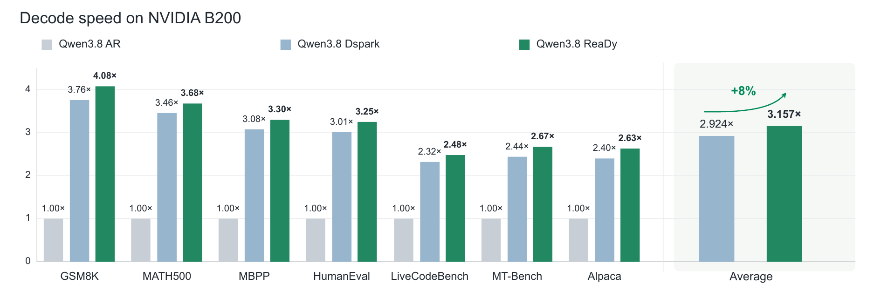
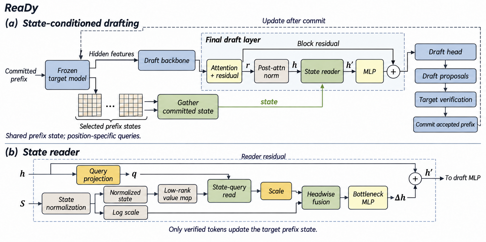
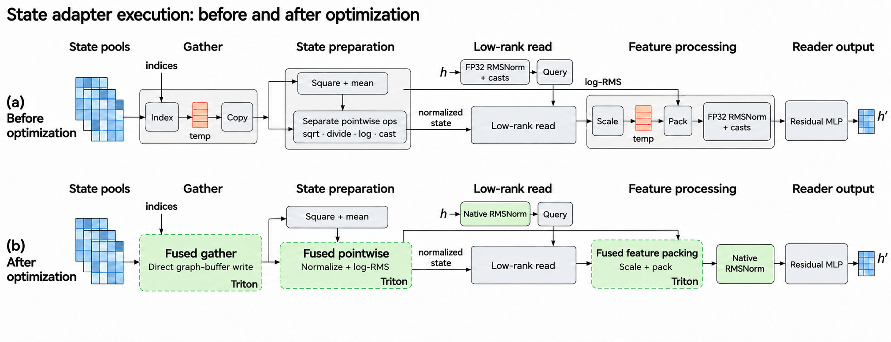

<div align="center">

# ReaDy

### Recurrent States as Dynamic Context for Speculative Drafting<br>in Hybrid Linear Attention Large Language Models

**A lightweight state reader for the next block of draft tokens.**

[🤗 Model weights](https://huggingface.co/startlux-models/ReaDy-Qwen3.8-27B) · [Quickstart](#quickstart) · [Environment](#environment)
</div>

ReaDy lets a speculative drafter query the target model's **committed recurrent states** for each upcoming draft position. A compact reader turns this context into a residual update to the draft representation, complementing the hidden features already used by DSpark. The target model then verifies the proposed tokens through SGLang.

This repository provides the inference implementation for **Qwen3.8-27B**, including the state reader, its SGLang integration, and custom Triton kernels (enabled by default). The full draft checkpoint and reader weights are available on Hugging Face.

## Results

<p align="center">
  
</p>

*Figure 1 from the paper.* On the reported seven-benchmark setup, ReaDy reaches approximately **3.16× decoding speedup over AR**, with **7.97% higher throughput** and **8.50% longer acceptance length** than DSpark on average. The Average panel reports the arithmetic mean of the seven per-benchmark speedups relative to AR. The figure uses the paper's reported temperature-0, thinking-mode measurements on an NVIDIA B200 with a seven-token draft block. Throughput measures decoding and excludes prefill. These are the paper's reported results, not a new full-benchmark measurement of the Triton reader backend.

## How it works

<p align="center">
  
</p>

Hidden features contain context that the target has already read for earlier predictions. ReaDy adds another read, guided by the representation of each future draft position:

1. **Read the committed state.** Retrieve the target's recurrent states for the current accepted prefix.
2. **Query by draft position.** Form a low-rank query from each draft representation and read the selected state heads.
3. **Update and verify.** Add the reader output as a residual to the drafter, produce the candidate block, and verify it with the target.

The released reader uses target layers **30 and 62** (zero-based), **rank 8**, and a residual injection at draft layer **4**, after attention normalization. Rank 8 applies to the value-map output and query factorization; the target's recurrent state remains **128 × 128**. See [MODEL_SPEC.txt](MODEL_SPEC.txt) for exact dimensions.

## What is included

| Component | Location |
| --- | --- |
| Full draft checkpoint and reader weights | [Hugging Face](https://huggingface.co/startlux-models/ReaDy-Qwen3.8-27B) |
| State reader and SGLang integration | [`ready_inference/`](ready_inference/) |
| Custom Triton reader kernels | [`ready_inference/kernels.py`](ready_inference/kernels.py) |
| Server launcher and request example | [`serve.py`](serve.py), [`generate.py`](generate.py) |
| Tested versions and source fingerprint | [`environment.json`](environment.json) |
| Functional equivalence checks | [`VALIDATION.json`](VALIDATION.json) |

The separate [Qwen3.8-27B target model](https://huggingface.co/Qwen/Qwen3.8-27B) and its tokenizer are required. This is a specialized draft checkpoint, not a standalone chat model.

## Environment

The validated configuration is **Linux · Python 3.12 · CUDA 12.9 · one NVIDIA B200**.

| Package | Tested version |
| --- | --- |
| PyTorch | `2.13.0+cu129` |
| Transformers | `5.6.2` |
| Triton | `3.7.1` |
| FlashInfer Python | `0.6.17` |
| SGLang kernel | `0.4.6.post1+cu129` |
| Safetensors | `0.7.0` |
| NumPy | `1.26.4` |
| Requests | `2.33.1` |
| Quack kernels | `0.3.11` |

SGLang source is pinned to [`29481685462732237d80d86076d6563e1f658102`](https://github.com/sgl-project/sglang/tree/29481685462732237d80d86076d6563e1f658102). The launcher uses that source directly and checks its SHA-256 fingerprint. The full upstream source is downloaded separately rather than vendored here.

Use a provisioned environment matching these versions, with compatible CUDA binaries and FlashInfer cubins. `environment.json` records the tested stack; it is not a complete dependency lockfile or a fresh-machine installer. Keep the verified engine checkout separate from any package-installation checkout: installing into it can generate extra Python files and fail the source-integrity check. Do not let the pinned engine's older dependency declarations replace the tested package versions.

## Quickstart

### 1. Get the code and pinned engine

```bash
git clone https://github.com/StartLuxLabs/ReaDy.git
cd ReaDy

# Requires Python 3.12 and Git; downloads and verifies source only.
python scripts/prepare_engine.py --destination third_party/sglang
```

### 2. Download the weights

With the [Hugging Face CLI](https://huggingface.co/docs/huggingface_hub/guides/cli) available:

```bash
hf download startlux-models/ReaDy-Qwen3.8-27B --local-dir checkpoint
hf download Qwen/Qwen3.8-27B --local-dir models/Qwen3.8-27B
```

Download the complete target repository, including tokenizer files, before launch. The server uses local files and does not download weights at runtime.

### 3. Verify the checkpoint and source

```bash
python serve.py \
  --target models/Qwen3.8-27B \
  --checkpoint checkpoint \
  --sglang-source third_party/sglang/python \
  --gpu 0 --check-only
```

This checks the checkpoint and engine hashes without starting a GPU server. The draft weight SHA-256 is `746f7d94f77d1d032614d2c0af805bf08cbe22b4a019b7ba84e103d36139c3ac`.

### 4. Start SGLang with ReaDy

```bash
python serve.py \
  --target models/Qwen3.8-27B \
  --checkpoint checkpoint \
  --sglang-source third_party/sglang/python \
  --reader-backend triton \
  --flashinfer-cubins /path/to/flashinfer-0.6.17-cubins \
  --gpu 0 --port 30000
```

Choose a GPU reserved for your process; `0` is an example. The server binds to `127.0.0.1`. Set `--flashinfer-cubins` to your matching 0.6.17 cubin directory; the recorded end-to-end checks used this explicit setting.

### 5. Generate

In another terminal using the same environment:

```bash
python generate.py \
  --target models/Qwen3.8-27B \
  --prompt "Explain why the sky appears blue." \
  --max-new-tokens 1024
```

The client applies the target tokenizer's thinking-mode chat template and sends a greedy request to `/generate`. It prints the response text and generation metadata. The checkpoint is loaded by SGLang's native DSpark implementation; `trust_remote_code` is not needed.

## Reference and Triton readers

| Backend | Flag | Implementation |
| --- | --- | --- |
| PyTorch reference | `--reader-backend reference` | Direct reader operations; explicit fallback for comparison |
| Custom Triton | `--reader-backend triton` | **Default**; fused state gather, normalization pointwise operations, and feature scaling/concatenation |

<p align="center">
  
</p>

The launcher defaults to **Triton**. To select the PyTorch reader explicitly, pass `--reader-backend reference`.

Both paths cooperate with SGLang and use its Triton attention backend. The custom reader switch is separate from the attention-backend choice. State reductions and matrix products retain their existing implementations; the entire reader is not a single fused kernel. Each proposal reads the current committed state into stable CUDA-graph buffers.

The runtime integration also preserves unified target verification and natural-EOS precedence at the output limit. Reader installation errors terminate the worker rather than silently reverting to the base drafter.

## Validated inference scope

| Setting | Value |
| --- | --- |
| Target / draft / KV precision | BF16, unquantized |
| Recurrent-state precision | FP32 |
| Serving | Single GPU, concurrency 1 |
| Sampling | Greedy, temperature 0 |
| Draft block | 7 tokens |
| Context limit | 16,384 tokens |
| Default generation limit | 1,024 new tokens, natural EOS |

The release passed checkpoint tensor checks, six CPU reader-equivalence cases, 24 B200 Triton kernel cases including CUDA-graph replay, and three end-to-end prompts with matching token IDs, text, and verification counts across the tested implementations. Exact scope is recorded in [VALIDATION.json](VALIDATION.json). Other hardware, batching modes, and stochastic decoding require separate validation.

## Acknowledgments

ReaDy builds on [DSpark](https://arxiv.org/abs/2607.05147), [SGLang](https://github.com/sgl-project/sglang), [Qwen](https://huggingface.co/Qwen), and [Triton](https://github.com/triton-lang/triton). Third-party source and weights retain their upstream licensing requirements; this repository does not grant additional rights to those components.

## Citation

```bibtex
@misc{ready2026,
  title = {ReaDy: Recurrent States as Dynamic Context for Speculative Drafting in Hybrid Linear Attention Large Language Models},
  author = {Bohan Sun and Zunhai Su and Xialie Zhuang and Jianjin Li and Ngai Wong and Chuan-Wei Kuo},
  year = {2026},
  url = {https://github.com/StartLuxLabs/ReaDy}
}
```
